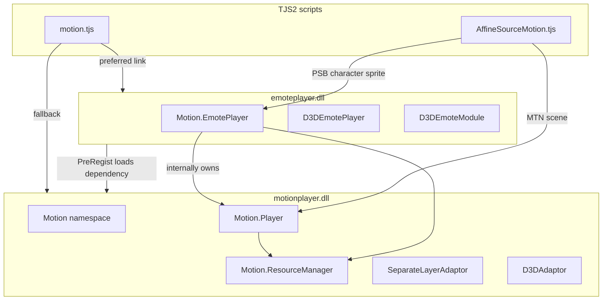

# MotionPlayer / EmotePlayer API and Usage Guide

> **Documentation index:** [`README.md`](README.md)  
> **Document version:** 2026-06-08  
> **Scope:** KrKr2 static plugin `cpp/plugins/motionplayer/` (replacement for the original `motionplayer.dll` + `emoteplayer.dll`)  
> **Script reference:** repository `data/system/` (KiriKiri scripts from the same lineage as NEKOPARA)  
> **Official pseudocode manual:** [`../manual.tjs`](../manual.tjs)  
> **progress behavior reference:** [`MOTIONPLAYER_PROGRESS.md`](MOTIONPLAYER_PROGRESS.md)

---

## 1. Overview

### 1.1 What they are

MotionPlayer and EmotePlayer both come from the **Motion / E-mote** plugin system developed by **M2 Inc.** for the KiriKiri / TVP engine. They are used for:

| Capability | Typical use |
|------|----------|
| **E-mote character sprites** | `.PSB` mesh deformation, mouth/eye/expression variables, differential Timelines, physics-driven movement |
| **Motion effects** | `.MTN` scene animations, KAG `[motion]` tags, button hit detection, Layer Motion |

In KrKr2, the two are **merged into the same C++ plugin directory** and statically linked into `krkr2plugin`. Scripts still trigger registration through `Plugins.link("emoteplayer.dll")` or `Plugins.link("motionplayer.dll")` (see `data/system/motion.tjs`).

### 1.2 Relationship between motionplayer and emoteplayer

In the original Windows distribution, these were **two DLLs**, with responsibilities divided as follows:



**KrKr2 implementation mapping (`main.cpp`):**

| Original module | TJS module name | C++ class | Registration location |
|----------|------------|--------|----------|
| `motionplayer.dll` | `motionplayer.dll` | `Motion`, `Player`, `ResourceManager`, `SeparateLayerAdaptor`, etc. | First `#define NCB_MODULE_NAME` section in `main.cpp` |
| `emoteplayer.dll` | `emoteplayer.dll` | `D3DEmoteModule`, `D3DEmotePlayer` (inherits `EmotePlayer`) | Second section in `main.cpp`; `EmotePlayer` is also registered as a subclass under `Motion.EmotePlayer` |

**Core architecture (aligned with reverse engineering of `libkrkr2.so`):**

```text
D3DEmotePlayer (optional Windows D3D path)
    └── EmotePlayer (thin wrapper, EmotePlayer.h)
            └── Player _player (all animation/rendering logic, Player.h)
                    └── ResourceManager + MotionSnapshot (PSB/MTN data)
```

Key points:

1. **EmotePlayer is not an independent engine.** It is a script-friendly wrapper around **Player**. Expressions, Timelines, and variables are ultimately processed inside `Player`.
2. **Player serves both product lines:** `.PSB` (E-mote) and `.MTN` (Motion). The scripting layer exposes different TJS classes for their respective APIs.
3. **ResourceManager** is shared by both and handles PSB/MTN loading, caching, `layerId`, and the PSB decryption hook.
4. KrKr2 also contains a separate stub file, `cpp/plugins/emotePlayer.cpp`, which only performs `LoadModule(motionplayer.dll)`. The **authoritative implementation is `motionplayer/main.cpp`**.

### 1.3 Similarities and differences compared with Live2D

> ⚠️ **Important clarification:** E-mote is **not** Live2D Cubism and does **not read** `.moc3` / `.model3.json`. References in the project documentation to a “Live2D-like style” only mean that the **product concept is similar**: mesh-based character sprites driven by expression parameters. See `docs/M09` / `docs/M12`.

| Dimension | E-mote (MotionPlayer) | Live2D Cubism |
|------|------------------------|---------------|
| Asset format | `.PSB` (E-mote), `.MTN` (Motion) | `.moc3` + textures + physics JSON |
| Parameter model | PSB `variable` table + Timeline controls such as `face_eye_open` | Parameter ID + animation curves |
| Mesh | Bezier mesh subdivision and deformation | Mesh + Deformer |
| Differential expressions | **Diff Timeline** + blend ratio | Expression / Motion files |
| Physics | `initPhysics`, wind, `hairScale` / `bustScale` | Physics JSON |
| Rendering | KiriKiri Layer / D3D / KrKr2 OpenGL | Cubism SDK renderer |
| Historical relationship | M2 E-mote was a contemporary industry solution; **no direct file compatibility** | — |

**Comparable scripting concepts:**

- `setVariable("face_mouth", …)` ≈ Live2D mouth parameter
- `playTimeline` + `setTimelineBlendRatio` ≈ expression blending
- `setCoord` / `setScale` / `setRotate` ≈ model matrix, though interpolation is performed by the plugin's internal Animator
- `contains("hit_bust", x, y)` ≈ Hit Area, with inverse affine transformation required on the script side

---

## 2. Data Formats and Script Branches

| Extension | PSB `type` | `_storageType` | TJS player | Typical use |
|--------|------------|----------------|------------|----------|
| `.PSB` | `1` = emote; **e-mote3 often uses `0` while still containing a variableList** | `"emote"` | `Motion.EmotePlayer` | Character sprites, MultiCache dual-character assets |
| `.MTN` | `0` = motion | `"motion"` | `Motion.Player` | KAG Motion, scene effects |

**How the script chooses a player:** `.PSB` character sprites use `Motion.EmotePlayer`, while `.MTN` files use `Motion.Player` (see `AffineSourceMotion._storageType`). This does not necessarily correspond one-to-one with the root PSB `type` field. e-mote3 files commonly use `type=0` while still having a `variableList`.

**Internal C++ `isEmoteLikeMotion()` — not a scripting API:** returns true when `type==1` or `variableLabels` is non-empty. This is used by the **Player runtime** to select the eval / `updateLayers` implementation branch (see [`MOTIONPLAYER_PROGRESS.md`](MOTIONPLAYER_PROGRESS.md) §2). It is **not** the sdl3 progress dual-path selector, nor is it the authoritative test for whether E-mote can run.

**Resource loading from scripts:**

```tjs
var data = motion_manager.load("path/to/chara.psb");
// data.metadata.base.chara / .motion are used for EmotePlayer initialization
```

MultiCache assets such as `a.psb:b.psb` are parsed by `splitStorage`. On the C++ side, `EmotePlayer::play` enters `MultiCache` mode and cross-links assets using `addEmoteFile`.

### 2.1 PSB sample and structure documentation

| Item | Value |
|----|-----|
| **Exported JSON** | [`tests/test_files/emote/e-mote3.0バニラパジャマa.json`](../../../../tests/test_files/emote/e-mote3.0バニラパジャマa.json) (**not** the runtime format) |
| **Runtime PSB** | Matching `.psb` with the same filename in the same directory |
| **Field dictionary** | [`MOTIONPLAYER_PSB_STRUCT.md`](MOTIONPLAYER_PSB_STRUCT.md) |
| **Texture world coordinates** | [`MOTIONPLAYER_TEXTURE_WORLD_COORDS.md`](MOTIONPLAYER_TEXTURE_WORLD_COORDS.md) |
| **C++ entry point** | `ResourceManager::load` → `emotefile::load` → `EmoteFileCore.cpp` |
| **Unit tests** | `tests/unit-tests/plugins/motionplayer-dll.cpp` |

**Temporary debugging:** when `kEmoteDebugDrawRedSquare == true` in `emoteplayerclass.cpp`, a red square is drawn at the center of the adaptor child layer every frame. This is used to verify the `draw()` → `MainImage` → screen compositing path. Once verified, set it to `false` or remove it.

---

## 3. TJS2 Scripting API Guide

### 3.1 Plugin loading and entry points

```tjs
// data/system/motion.tjs
Plugins.link("emoteplayer.dll");  // preferred; internally loads motionplayer.dll
// or Plugins.link("motionplayer.dll");

var mgr = new MotionResourceManager(kag);  // wraps Motion.ResourceManager
```

**Global class overview:**

| Class | Purpose |
|----|------|
| `Motion` | Static utilities, `getD3DAvailable()`, enum constants |
| `Motion.ResourceManager` | PSB/MTN loading and caching |
| `Motion.EmotePlayer` | E-mote character sprites |
| `Motion.Player` | Motion / MTN |
| `Motion.SeparateLayerAdaptor` | Separate-layer rendering (**recommended**) |
| `Motion.D3DAdaptor` | Windows D3D canvas; mostly stubbed in KrKr2 |
| `D3DEmotePlayer` / `D3DEmoteModule` | Windows D3D-specific emote path |

### 3.2 Motion namespace constants

Registered in `main.cpp` → `NCB_REGISTER_CLASS(Motion)`:

| Constant | Value | Meaning |
|------|-----|------|
| `LayerTypeObj` … `LayerTypeCamera` | 0–5 | Node layer type |
| `ShapeTypePoint/Circle/Rect/Quad` | 0–3 | Hit-test shape |
| `PlayFlagForce` | 1 | Force playback |
| `PlayFlagChain` | 2 | Chain playback |
| `PlayFlagAsCan` | 4 | Play if possible |
| `PlayFlagJoin` | 8 | Join |
| `PlayFlagStealth` | 16 | Stealth playback |
| `TransformOrderFlip/Angle/Zoom/Slant` | 0–3 | Transform order |
| `CoordinateRecutangularXY/XZ` | 0–1 | Coordinate system; original spelling retained |
| `MaskModeStencil` / `MaskModeAlpha` | 0 / 1 | Stencil / alpha masking |

**Additional D3DEmoteModule constants:**

| Constant | Value |
|------|-----|
| `TimelinePlayFlagParallel` | 1 |
| `TimelinePlayFlagSequential` | 2 |

> ⚠️ **Ambiguity:** `manual.tjs` calls the latter `TimelinePlayFlagDifference`, whereas the C++ registration uses `TimelinePlayFlagSequential`. The actual scripts use **numeric flags**: main=1, diff=3. See §3.4.

### 3.3 Motion.EmotePlayer — properties

| Property | Access | Description |
|------|------|------|
| `module` | RO | Bound PSB module object |
| `chara` | RW | Character name |
| `motion` | RW | **Current clip name**, not file path; `play()` starts playback |
| `motionKey` | RW | Cache key (`Storages.getPlacedPath`); binds a PSB already loaded into ResourceManager |
| `completionType` | RW | Interpolation type; E-mote recommends `stFastLinear` — a script constant, not a plugin enum |
| `maskMode` | RW | `Motion.MaskModeAlpha` recommended |
| `visible` | RW | Visibility |
| `smoothing` | RW | Smoothing on the EmotePlayer wrapper |
| `meshDivisionRatio` | RW | Mesh subdivision ratio |
| `queing` | RW | Original spelling **queing**, not queuing; obsolete, keep `false` |
| `hairScale` / `partsScale` / `bustScale` / `bodyScale` | RW | Physics-region scaling |
| `useD3D` | RW | Whether to use D3D rendering; KrKr2 defaults to OpenGL. Can be set to true, though behavior may differ from the original Windows implementation |
| `progress` | RW | Progress field on the EmotePlayer wrapper |
| `modified` / `drawvisible` / `drawOpacity` / `opengl` | RW | Drawing state |
| `animating` | RO | Whether animation is still running; maps to `Player.allplaying` |
| `playCallback` | RO | Playback callback flag |
| `outline` / `priorDraw` / `frameLastTime` / `frameLoopTime` / `loopTime` | RW | Forwarded to Player |

### 3.4 Motion.EmotePlayer — methods

#### Lifecycle and state

| Method | Signature | Effect |
|------|------|------|
| `create` | `()` | **Resets/destroys** internal state, matching the original `create=reset` semantics |
| `load` | `(data)` | Loads a module variant |
| `clone` | `()` → new instance | Copies the EmotePlayer + Player snapshot |
| `serialize` / `unserialize` | `()` / `(data)` | State serialization; affine state etc. Full Timeline state is **partially implemented** |
| `show` / `hide` | `()` | Visibility |
| `assignState` | `()` | Synchronizes wrapper properties into Player |
| `initPhysics` | `(rule?)` | Loads physics rules from PSB metadata |

#### Affine transforms and appearance, with ms interpolation

| Method | Signature | Effect |
|------|------|------|
| `setCoord` | `(x, y, time=0, easing=0)` | Character position; **time is in milliseconds** |
| `setScale` | `(scale, time=0, easing=0)` | Scale; internally `finalScale = baseScale * userScale` |
| `setRot` / `setRotate` | `(rad, time=0, easing=0)` | Rotation in radians |
| `setColor` | `(color, time=0, easing=0)` | Diffuse color `0xAARRGGBB` |
| `setMirror` | `(bool)` | Mirroring; incremental flip relative to baseline |
| `setDrawAffineTranslateMatrix` | `(a, b, c, d, tx, ty)` | Composes with the Layer affine chain |

> ⚠️ **Ambiguity — getter return values:** in the KrKr2 implementation, `getRot()` / `getScale()` / `getColor()` are **aligned with the original hardcoded behavior** and commonly return `0` / `1.0` / `0` respectively. These values **do not represent** the current interpolated animation state. Use setter-side cached values or the visual result instead.

**Easing convention (`manual.tjs`):** negative = ease-in, positive = ease-out, 0 = linear.

#### Variable system — core of E-mote

| Method | Signature | Effect |
|------|------|------|
| `setVariable` | `(name, value, time=0, easing=0)` | Drives parameters such as mouth, eyes, head, etc. |
| `getVariable` | `(name)` | Current resolved value |
| `countVariables` / `getVariableLabelAt` / … | Indexed API | Introspection |
| `getVariableFrameList` | `(name)` | Frame-label list |

**Common variables used by `AffineSourceMotion.resetEmoteVariables`:**

`move_UD`, `move_LR`, `head_UD`, `head_LR`, `head_slant`, `body_*`, `face_talk`, `face_eye_*`, `face_mouth`, `face_tears`, `face_cheek`, `act_sp`

#### Timeline — differential expressions

| Method | Signature | Effect |
|------|------|------|
| `getMainTimelineLabelList` | `()` | Array of main Timeline names |
| `getDiffTimelineLabelList` | `()` | Array of differential Timeline names |
| `playTimeline` | `(name, flags=0)` | Starts playback; scripts commonly use **main=1, diff=3** |
| `stopTimeline` | `(name="")` | Stops playback |
| `getTimelinePlaying` / `isTimelinePlaying` | `(name="")` | Whether playback is active |
| `getLoopTimeline` / `isLoopTimeline` | `(name)` | Whether the Timeline loops |
| `getTimelineTotalFrameCount` | `(name)` | Total frame count |
| `setTimelineBlendRatio` | `(name, ratio)` **NCB only has 2 parameters** | Differential blend ratio; script `_playTimeline` also passes `time, easing` → **see ambiguity below** |
| `fadeInTimeline` / `fadeOutTimeline` | `(name, duration, flags?)` | Fade in/out |
| `getPlayingTimelineInfoList` | `()` | `[{label, flags, blendRatio}, …]` |
| `setTimeline` | `(label, loop)` | KrKr2 maps this to `playTimeline(label, 0)`; semantics are **incomplete** |

**Script wrapper `_playTimeline` (`AffineSourceMotion.tjs`):**

```tjs
// main timeline
_player.playTimeline(name, 1);
// diff timeline: parallel + difference
_player.playTimeline(name, 3);
_player.setTimelineBlendRatio(name, ratio, time * 60 / 1000, easing);
```

> ⚠️ **Ambiguity:** the script converts **milliseconds into frame time** using `* 60/1000` before passing the blend duration. The C++ NCB registration for `setTimelineBlendRatio` only declares `(label, ratio)`. Whether the extra `time/easing` parameters actually take effect depends on how complete the `setTimelineBlendRatio` compatibility implementation is. Some of the implementation uses Player's internal Animator. Verify visually against NEKOPARA.

#### Playback loop

| Method | Signature | Effect |
|------|------|------|
| `play` | `(label, flags=0)` | Starts a clip; three modes: motionKey / SingleCache / MultiCache |
| `progress` | `(tickStep_ms)` | Advances by **milliseconds**; internally converted to frame time using `× 60/1000` |
| `draw` | `(layer \| SeparateLayerAdaptor)` | Renders to a Layer or separate adaptor |
| `skip` | `()` | Jumps to the end |
| `pass` | `()` | **No arguments**; used for end-of-line sync and time fast-forward semantics |
| `skipToSync` | `()` | Jumps to a sync point |
| `addPlayCallback` / `pass` | | Callback-related |

> ⚠️ **Previous incompatibility:** an older implementation defined `pass(double)`, causing `Invalid argument count`. It has now been changed to the zero-argument form. See PLAN §11.1.

#### Physics and interaction

| Method | Signature | Effect |
|------|------|------|
| `startWind` | **manual:** `(start, goal, speed, powMin, powMax)` | Wind effect |
| | **C++ NCB:** `(minAngle, maxAngle, amplitude, freqX, freqY)` | Five-parameter angle/frequency model |
| | **AffineSourceMotion:** `_player.startWind(.start, .goal, .speed, .min, .max)` | Corresponds to environment wind-dictionary fields |
| `stopWind` | `()` | Stops wind |
| `setOuterForce` | `(label, x, y, time?, easing?)` or `(x, y)` | External force applied to hair/chest/parts |
| `getOuterForce` | `()` | Query |
| `contains` | `(x, y)` or `(label, x, y)` | Hit test; label example: `hit_bust` |

> ⚠️ **Ambiguity:** `manual.tjs` and the C++ header disagree on the meaning of the `startWind` parameters. Use the **actual call in `AffineSourceMotion.updateEnvironment`** as the reference: the five fields from the wind dictionary.

### 3.5 Motion.Player — scripting API summary

Used for `.MTN` / KAG Motion (`AnimKAGLayer.tjs`, `GFX_Motion.tjs`).

**Player-specific APIs not exposed by EmotePlayer:**

| Category | API |
|------|-----|
| Playback control | `play(motion, flags)`, `stop()`, `isPlaying()`, `playing`, `allplaying` |
| Callbacks | `motion` property setter triggers `onFindMotion`; `onAction` |
| Time | `tickCount`, `frameTickCount`, `speed` — **bool flag**, not floating-point playback speed; see ambiguity |
| Layers | `getLayerGetter`, `getLayerNames`, `getLayerMotion`, `setFlip`, `setZoom`, `setOpacity`, `setSlant` |
| Synchronization | `syncWaiting`, `syncActive`, `skipToSync`, `releaseSyncWait` |
| Stealth | `stealthChara`, `stealthMotion` |
| Selectors | `isSelectorTarget`, `deactivateSelectorTarget`, `selectorEnabled` |
| Camera/stereo | `hasCamera`, `cameraActive`, `stereovisionActive`, … |
| Other | `frameProgress`, `motionList`, `emoteEdit`, `colorWeight`, `unload`, … |

**Position properties on the Player root node:** `x`, `y`, `left`, `top`

### 3.6 Motion.ResourceManager

```tjs
var rm = new Motion.ResourceManager(kag, cacheSize);
var mod = rm.load(path);           // → TJS object containing metadata
rm.unload(path);
rm.clearCache();
rm.loadSource(path); rm.findSource(path);
rm.requireLayerId(name); rm.releaseLayerId(id);

// Static hooks (NEKOPARA: seed = 742877301)
Motion.ResourceManager.setEmotePSBDecryptSeed(seed);
Motion.ResourceManager.setEmotePSBDecryptFunc(func);
```

### 3.7 SeparateLayerAdaptor — recommended rendering path

```tjs
var adaptor = new Motion.SeparateLayerAdaptor(layer);
adaptor.targetLayer = layer;
adaptor.absolute = index;
player.draw(adaptor);   // does not contaminate parent Layer pixels
```

`AffineSourceMotion` automatically creates `_motionSeparateAdaptor` on the `AffineLayer` and reference-counts it.

---

## 4. Standard Usage Flow

### 4.1 E-mote character sprite — minimal flow

Corresponds to `manual.tjs` and `AffineSourceMotion.createPlayer`:

```tjs
var resourceManager = new Motion.ResourceManager(window, 20 * 1024 * 1024);
var path = "emote/chara.psb";
var data = resourceManager.load(path);

var player = new Motion.EmotePlayer(resourceManager);
player.motionKey = Storages.getPlacedPath(path);
player.chara = data.metadata.base.chara;
player.play(data.metadata.base.motion, Motion.PlayFlagForce);
player.initPhysics(data.metadata);
player.completionType = stFastLinear;
player.maskMode = Motion.MaskModeAlpha;

// Game loop — AffineSourceMotion is driven by the Layer; see §4.2
var prevTick = System.getTickCount();
for (;;) {
  var dt = System.getTickCount() - prevTick;
  prevTick += dt;
  player.progress(dt);
  player.draw(adaptor);
}
```

### 4.2 AffineSourceMotion per-frame pipeline — production path

```text
drawAffine(target, src)
  ├─ calcMatrix → setCoord / setRotate / setScale / meshDivisionRatio / *Scale
  ├─ progress(_interval) or progress(0)
  ├─ setDrawAffineTranslateMatrix(a,c,b,d,tx,ty)  // inverse-calculated from Layer affine transform
  ├─ completionType = src._completionType
  └─ draw(target | _motionSeparateAdaptor)
```

**End-of-line sync — dialogue waits for animation to finish:**

```tjs
_player.pass();        // no arguments
_player.progress(1);   // advance 1 ms
```

### 4.3 Motion / MTN — KAG

```tjs
var player = new Motion.Player(motion_manager.resourceManager);
player.onAction = function(...) { ... };
player.play(elm.motion, Motion.PlayFlagForce);
// Every frame
player.progress(interval_ms);
player.draw(separateLayerAdaptor);
```

### 4.4 Timeline and `emo` tags — game layer

The game's `emotion.tjs` does **not directly call the plugin**. Instead, `AffineSourceMotion._setOptions` parses KAG elements:

- `elm.timeline` → `_playTimeline` / `_stopTimeline`
- `elm.variables` → `setVariable`
- `elm.stoptimeline` / `resetEmoteVariables`

---

## 5. C++ Technical API — Developers

### 5.1 Namespaces and files

| Component | Header | Description |
|------|--------|------|
| `motion::Player` | `Player.h` + `Player*.cpp` | Core; roughly 15 translation units |
| `motion::EmotePlayer` | `EmotePlayer.h/.cpp` | Thin delegating wrapper |
| `motion::ResourceManager` | `ResourceManager.h/.cpp` | Cache and layerId management |
| `motion::SeparateLayerAdaptor` | `SeparateLayerAdaptor.*` | Separate FBO layer |
| `motion::D3DAdaptor` | `D3DAdaptor.*` | D3D path |
| `detail::MotionSnapshot` | `RuntimeSupport.h` | Parsed PSB snapshot |
| `detail::PlayerRuntime` | `RuntimeSupport.h` | Runtime node tree and Timeline state |

### 5.2 Core Player C++ API — excerpt

```cpp
namespace motion {
class Player {
public:
    explicit Player(ResourceManager rm = {}, Player* parent = nullptr);

    // Properties: chara, motionKey, maskMode, frameLoopTime, playing, useD3D, ...
    void setMotion(ttstr v);
    void loadFromSnapshot(std::shared_ptr<detail::MotionSnapshot>);
    void addEmoteFile(std::shared_ptr<detail::MotionSnapshot>);
    void bindMotionModuleKey(ttstr storageKey);

    // E-mote controls
    void setEmoteCoord(double x, double y, double transition=0, double ease=0);
    void setEmoteScale(double scale, double transition=0, double ease=0);
    void setVariable(ttstr label, double value, double transition=0, double ease=0);
    void playTimeline(ttstr label, tjs_int flags);

    // Playback / stepping
    bool playMotionLike_0x6B2284(ttstr label, tjs_int flags);
    void progressMsLike_0x6D2A54(double deltaMs);
    void progressEmoteLike_sdl3(double deltaMs, iTJSDispatch2* objthis);
    void updateLayersEmoteLike_sdl3();
    void frameProgress(double dt_frames);
    void updateLayers();

    // Rendering
    void draw(tTJSVariant target);
    bool hitTestLayer(ttstr name, double x, double y);

    // ncbind static compatibility functions
    static tjs_error progressCompatMethod(...);
    static tjs_error playCompat(...);
};
}
```

### 5.3 EmotePlayer C++ API — excerpt

```cpp
class EmotePlayer {
    Player _player;  // sole animation core
    ttstr _storageKey, _clipLabel;
    bool play(ttstr label, tjs_int flags = 0);
    void progress(double dt_ms);
    void pass();  // no arguments
    // setCoord/setScale/... → forwarded to Player::setEmote*
};
class D3DEmotePlayer : public EmotePlayer {};
```

### 5.4 progress and updateLayers — implementation notes; code is authoritative

**Two script entry paths — do not mix them up:**

| Script class | C++ entry point | Current behavior — 2026-05-28 |
|--------|----------|------------------------|
| `Motion.EmotePlayer` | `EmotePlayer::progress` → **`progressMsLike_0x6D2A54`** | `frameProgress` + **`updateLayersEmoteLike_sdl3`** + `calcBounds` |
| `Motion.Player` | **`progressCompatMethod`** | If `isEmoteLikeMotion` → `progressEmoteLike_sdl3`; otherwise `frameProgress` + full `updateLayers` |

The production character-sprite path through `AffineSourceMotion` uses **EmotePlayer → progressMsLike** and **does not pass through `progressCompatMethod`**.

**sdl3 reference:** there is only one `EmotePlayer::progress`. Internally it checks `_varList.size()>0` to decide what `tick` value is passed to the tree — 0 versus `clockPassed`. There is **no** KrKr2-style `progressEmoteLike` / `frameProgress` function pair. See [`MOTIONPLAYER_PROGRESS.md`](MOTIONPLAYER_PROGRESS.md) §0 errata.

**`updateLayers()`:** internally calls `updateLayersEmoteLike_sdl3` when `isEmoteLikeMotion` is true, skipping part of Phase 3; otherwise it runs full Phase 3. This is a **choice of Layer-update implementation**, not evidence that the public progress API itself must maintain two separate paths.

### 5.5 Rendering stack — KrKr2

```text
Player::draw → renderToLayer / renderToSeparateLayerAdaptor / renderToD3DAdaptor
    → prepareRenderItems → buildRenderCommands → executeLayerRenderCommands
    → PrivateMotionGLL + cpp/core/visual/ogl
```

The SDL-created GL context under the `sdl3/` directory is **not used**. That code is reference-only.

### 5.6 ncbind registration

- Module names: `TJS_W("motionplayer.dll")` / `TJS_W("emoteplayer.dll")`
- `PostRegistCallback`: aliases the global `Player` class to `Motion.Player`; injects a class-level `useD3D` capability-detection object
- For the complete registration table, **`main.cpp` is authoritative** and supersedes the subset documented here

---

## 6. Effects — API to Visual/Behavioral Result

| API / data | Expected effect |
|------------|----------|
| `play` + idle clip | Character breathing / idle loop |
| `setVariable("face_mouth", n)` | Mouth-frame switching |
| `playTimeline` + diff blend | Differential facial expression overlay — angry, smiling, crying, etc. |
| `setTimelineBlendRatio` | Controls diff intensity from 0→1 |
| `setCoord/Scale/Rotate` + time | Smoothly interpolated character translation, scaling, and rotation |
| `startWind` + `hairScale` | Hair sways in the wind |
| `setOuterForce("hair", x, y)` | Local mesh displacement |
| `meshDivisionRatio` | Mesh density; affects deformation quality and performance |
| `maskMode = Alpha` | Correct blending around translucent edges |
| `SeparateLayerAdaptor` | Separate buffer preventing contamination of the Affine parent layer |
| `Motion.Player.play` + MTN | Scene Motion, buttons, particles, camera animations |
| `skipToSync` / `pass` | Dialogue-line ending waits for animation to reach a synchronization point |

---

## 7. Ambiguities, Unclear Areas, and KrKr2 Implementation Status

### 7.1 Documentation/signature inconsistencies

| Item | Description |
|----|------|
| `TimelinePlayFlagDifference` vs `TimelinePlayFlagSequential` | Manual and C++ use different names; scripts use **integers 1/3** |
| Five `startWind` arguments | Manual, C++ header, and AffineSourceMotion give three different descriptions; **use the game's wind dictionary as authoritative** |
| Number of `setTimelineBlendRatio` parameters | Script passes 5 arguments; NCB declares 2; `time/easing` **may not be fully ported** |
| `Player.speed` | C++ stores `_speed` as a **bool**; MTN script applies `+elm.speed` numerically, so any non-zero value becomes true |
| `getRot/getScale/getColor` | Return constants rather than live values |
| `queing` vs `queuing` | Property retains original typo, `queing` |
| `EmotePlayer.create` | Called create, but actually performs a **reset** |
| `typeof _player.clear` | Script checks for an optional `clear`; EmotePlayer **may not have** `clear` and may rely on the draw path to self-clear |
| `completionType` | Value comes from KiriKiri Layer constants such as `stFastLinear`, not a Motion-plugin enum |

### 7.2 Data format and diagnostic logs

| Item | Description |
|----|------|
| PSB `type=0` + variableList | Common with e-mote3; scripts still use `EmotePlayer`. An **`emoteMode=0` log only reflects the type field and cannot by itself prove a fault** |
| `isEmoteLikeMotion` | Internal KrKr2 heuristic; **do not equate it with a requirement to split the progress path** |
| `_findMotionContextVariant` (`player+1012`) | Reverse-engineered name is still incomplete; related to propagation of the `findMotion` context |
| Primary PSB selection in MultiCache | Primary selected according to non-empty metadata `chara` + `motion`; ordering depends on cache iteration |
| Historical claim that “hang = child Player running full updateLayers” | **Obsolete and unverified**; see `MOTIONPLAYER_PROGRESS.md` §0 |

### 7.3 KrKr2 implementation completeness — 2026-05-28

| Area | Status |
|------|------|
| Plugin registration / ResourceManager load | ✅ Basically functional |
| EmotePlayer MultiCache play / pass() | ✅ Fixed — PLAN §11 |
| EmotePlayer progress | `progressMsLike` → `updateLayersEmoteLike_sdl3`; architecturally **different from sdl3**, alignment still requires separate validation |
| `Motion.Player` progress | `progressCompatMethod` contains an `isEmoteLikeMotion` branch, separate from the EmotePlayer path |
| Rendering draw / visible / stencil | ⏳ Partial; may produce `draw=n` |
| Timeline blend / eyeControl | ⏳ In progress; sdl3 `updateEyeControl` not fully ported |
| Full MTN Motion | ⏳ Phase 2 |
| initPhysics / wind / hit | ⏳ P2 |
| D3DEmoteModule / D3D path | Stub; KrKr2 uses OpenGL |
| `Motion.getD3DAvailable()` | KrKr2 **always returns true**, indicating an available GPU path rather than actual D3D |

**Recommended validation:**

- Real game: NEKOPARA Vol.0 — see PLAN §1.4
- Unit tests: `tests/unit-tests/plugins/motionplayer-render.cpp`
- Texture golden tests: `tools/psb-export` + `tools/visual-test`

### 7.4 Concepts that should not be confused

| Incorrect interpretation | Correct interpretation |
|----------|----------|
| EmotePlayer is an independent renderer | It delegates to an internal **Player** |
| motionplayer only handles MTN | It also registers **Motion.EmotePlayer**; the Player core handles PSB as well |
| E-mote = Live2D | Only conceptually similar; **formats and APIs are incompatible** |
| `progress(0)` does nothing | It still refreshes a frame, even without new wall-clock time |
| The `setDrawAffineTranslateMatrix(mtx.m11, …)` branch should be used | It is disabled by **`if (false)`** in AffineSourceMotion; the inverse-calculated six-argument form is used |

---

## 8. Quick Reference

| Requirement | Script entry point | C++ entry point |
|----------|----------|----------|
| Load PSB | `ResourceManager.load` | `ResourceManager::load` → `loadMotionSnapshot` |
| Create character sprite | `new Motion.EmotePlayer(rm)` | `EmotePlayer::EmotePlayer` |
| Per-frame update | `player.progress(ms)` | **`EmotePlayer::progress` → `progressMsLike_0x6D2A54`** — not `progressCompatMethod` |
| Render | `player.draw(adaptor)` | `EmotePlayer::draw` → `Player::draw` |
| Expression variable | `setVariable` | `Player::setVariable` + animators |
| Differential face expression | `playTimeline` + blend | `PlayerTimeline.cpp` |
| Scene Motion | `Motion.Player.play` | `playMotionLike_0x6B2284` |
| Hit testing | `contains("hit_bust", x, y)` | `Player::hitTestLayer` |

---

## 9. Related Documentation

See **[`README.md`](README.md)** for the complete documentation index.

---

## 10. Maintenance Notes

- **API source-of-truth priority:** scripts from the running game (`data/`) > NCB registration in `main.cpp` > `manual.tjs` > this document.
- When inconsistencies are found, use the **code and actual NEKOPARA runtime behavior** as authoritative, then update §7 of this document.
- **progress errata:** see [`MOTIONPLAYER_PROGRESS.md`](MOTIONPLAYER_PROGRESS.md) §0.

| Date | Description |
|------|------|
| 2026-05-28 | Initial version |
| 2026-05-28 | Errata: progress entry points, `isEmoteLikeMotion`, logging, and hang-related explanation |