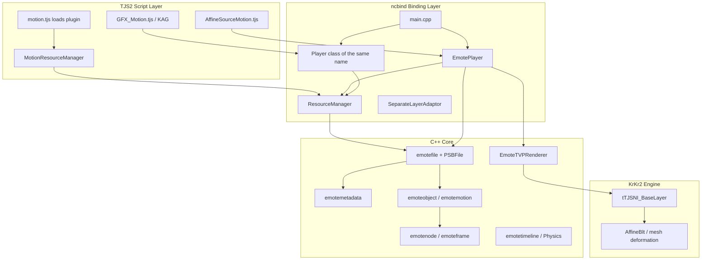

# MotionPlayer Architecture Overview

> **Documentation index:** [`README.md`](README.md)  
> **Document version:** 2026-06-08  
> **Code path:** `cpp/plugins/motionplayer/`  
> **Sample data:** [`tests/test_files/emote/e-mote3.0バニラパジャマa.json`](../../../../tests/test_files/emote/e-mote3.0バニラパジャマa.json) (exported from the corresponding `.psb` using `psbfile`; **not the runtime format**)  
> **API and scripting usage:** [`MOTIONPLAYER_API_GUIDE.md`](MOTIONPLAYER_API_GUIDE.md)  
> **PSB field dictionary:** [`MOTIONPLAYER_PSB_STRUCT.md`](MOTIONPLAYER_PSB_STRUCT.md)  
> **Rendering/debugging:** [`MOTIONPLAYER_RENDER_TEST.md`](MOTIONPLAYER_RENDER_TEST.md)

---

## 1. Overview

MotionPlayer is KrKr2's implementation of the **Motion / E-mote** plugins provided by M2 Inc. for KiriKiri / TVP. On the original Windows implementation, these are split into `motionplayer.dll` (MTN scene animation) and `emoteplayer.dll` (PSB character sprites). This repository **combines both into the static library** `motionplayer`, which is linked into the engine through `krkr2plugin`.

| Product line | File extension | Script player | Typical use |
|--------|------------|------------|----------|
| **E-mote** | `.PSB` | `Motion.EmotePlayer` | Character sprites, lip sync/blinking, variant Timelines, physics |
| **Motion** | `.MTN` | `Motion.Player` | KAG `[motion]`, scene effects, button Hit regions |

The script chooses the player based on the **file extension**. There is no strict one-to-one mapping to the PSB root field `object.*.type` (`type: 0` is common in E-mote 3.0 files, but these still use `EmotePlayer`).

---

## 2. Layered Architecture



### 2.1 Division of Responsibilities

| Layer | Responsibility |
|------|------|
| **Script** | Plugin loading, resource reference counting, affine composition, mapping KAG tags to `setVariable` / `playTimeline` |
| **EmotePlayer** | TJS property/method wrapper; owns `emotefile*`, the current `emotemotion*`, and the `clockPassed` clock |
| **emotefile** | PSB parsing, animation-tree construction, variable/Timeline/physics/blinking updates |
| **emotenode** | Node-tree traversal, `progress` evaluation, `drawToLayer` / offscreen bitmap |
| **EmoteTVPRenderer** | Bezier mesh subdivision, `AffineBlt` triangle patches |
| **psbfile** | `PSBFile` binary table reading, `readAllObjs` JSON export (for debugging) |

> **Note:** The comment saying "EmotePlayer and Player are the same thing" means that, in the current KrKr2 implementation, **character-sprite logic is concentrated in `EmotePlayer` + `emotefile`**. The original Windows `Motion.Player` is a heavier MTN/sub-Player-tree implementation. In this repository, the `Player` class is registered alongside `EmotePlayer`, and the MTN path is still under development.

---

## 3. Source Module Map

```text
cpp/plugins/motionplayer/
├── main.cpp                 # ncbind: registers both motionplayer.dll / emoteplayer.dll module names
├── emoteplayerclass.h/.cpp  # ResourceManager, EmotePlayer, SeparateLayerAdaptor
├── emotefile.h              # Data-model overview (nodes/frames/metadata/physics)
├── EmoteFileCore.cpp        # load → GenerateAniTree(), root object parsing
├── EmoteMetadata.cpp        # metadata: base, timeline, variable, eye/hair/bust…
├── EmoteMotion.cpp          # emoteobject, emotemotion
├── EmoteNode.cpp            # emotenode, emoteframe, progress/draw
├── EmoteTimeline.cpp        # emotetimeline, emoteTimeVar
├── EmotePhysics.cpp         # Wind, hair-strand, bust-sway simulators
├── EmoteFrame.cpp           # Frame content parsing
├── EmoteInternal.cpp        # Bezier mesh point evaluation
├── EmoteTVPRenderer.cpp     # TVP affine mesh rendering
└── docs/                    # This document, API guide, progress comparison
```

Dependencies: `psbfile` (`PSB::PSBFile`), `krkr2plugin`, OpenCV (texture decoding), glm (matrices).

---

## 4. Runtime Data Flow

### 4.1 Loading

```text
ResourceManager::load(path)
  → emotefile::load(path)
      → PSBFile::loadPSBFile
      → emotefile::GenerateAniTree()
           ├─ spec → isKrkr / colorType
           ├─ metadata → emotemetadata
           ├─ object   → map<chara, emoteobject>
           ├─ screenSize → _limitArea baseline
           ├─ source   → texture/icon dictionary
           └─ scan motion tree to calculate syncTime
  → return file->root() to TJS (Dictionary containing metadata etc.)
```

On the script side (`AffineSourceMotion`):

1. `motion_manager.load("xxx.psb")` obtains `metadata`
2. `new Motion.EmotePlayer(rm)`, with `motionKey` = placement path
3. `chara` / `play(metadata.base.motion)` / `initPhysics(metadata)`

### 4.2 Per-frame Update (E-mote)

```text
AffineSourceMotion.drawAffine
  → setCoord / setScale / setRotate / setVariable…
  → _player.progress(interval_ms)
  → _player.draw(SeparateLayerAdaptor | Layer)
```

Core branches in `EmotePlayer::progress` (`emoteplayerclass.cpp`):

| Condition | Behavior |
|------|------|
| `_metadata->_varList` is non-empty (E-mote character sprite) | `updateEyeControl` + `updateTimelineControl`; `emotemotion::progress(0, …)` (the Timeline drives variables, while node ticks receive 0) |
| Otherwise (more MTN-like / no variable table) | Advance `clockPassed`; `progress(clockPassed, …)`; stop at `lastTime` or `syncTime` |

### 4.3 Drawing

```text
EmotePlayer::draw(layer)
  → drawWithTVP
      ├─ clearLayerMainImage (optional)
      ├─ offscreen tTVPBaseTexture(_width, _height)
      ├─ emotemotion::drawToBitmap / drawToLayer
      │     └─ recursive emotenode traversal: mesh deformation + EmoteTVPRenderer::drawPatch
      └─ MainImage.AffineBlt composite onto target Layer
```

`SeparateLayerAdaptor` provides an independent child Layer on top of `AffineLayer`, avoiding modification of the parent layer's pixels (created with reference counting when `entryOwner` is set).

### 4.4 MultiCache

When the path has the form `a.psb:b.psb`, `play` calls `addEmoteFile` between multiple `emotefile` instances in `cacheData`, cross-mounting them so that resources can be resolved/shared between two characters.

---

## 5. In-Memory Object Model (C++)

Correspondence with JSON / PSB fields:

```text
emotefile
├── _metadata: emotemetadata
│   ├── base: chara, motion            ← metadata.base
│   ├── _varList: map<label, float>    ← metadata.variableList (labels only, initial value 0)
│   ├── _timelineControl[]              ← metadata.timelineControl
│   ├── _eyeControl / _eyebrowControl
│   ├── _hairControl / _partsControl / _bustControl
│   └── _selectorControl / _attrcomp
├── _objects: map<string, emoteobject*>
│   └── motion: map<string, emotemotion*>
│       ├── layer[]: emotenode* trees
│       ├── nodeList: flat list (for traversal)
│       ├── parameter[]: emoteVar* (parameterized nodes)
│       └── lastTime, syncTime, loopTime
├── _source: map<string, emotesource*>
│   └── icon: map<string, emoteicon*>
└── _screenSize, _stereovisionProfile
```

Key **emotenode** fields:

| Field | Meaning |
|------|------|
| `type` | Node type (layout/blank/patch/template mask/etc.; see §6.4) |
| `frameList` | Keyframe sequence |
| `children` | Child nodes |
| `label` | Layer name, Hit name, motion reference path |
| `meshDivision` | Mesh subdivision density → rendering performance |
| `parameterize` | Bound to an `emoteVar`; the variable drives the frame index |

Common keys in **`emoteframe.content`**: `coordX/Y/Z`, `angle`, `sx/sy`, `zx/zy`, `opa`, `src` (`layout` / `blank/…` / `motion/…`), `bp` (32 Bezier control points), `mask`.

---

## 6. E-mote 3.0 Data Format (Index)

For the complete field table with `✅/⚠️` annotations, see **[`MOTIONPLAYER_PSB_STRUCT.md`](MOTIONPLAYER_PSB_STRUCT.md)**. For the composition rules used to derive texture world coordinates, see **[`MOTIONPLAYER_TEXTURE_WORLD_COORDS.md`](MOTIONPLAYER_TEXTURE_WORLD_COORDS.md)**.

| File | Description |
|------|------|
| `e-mote3.0バニラパジャマa.psb` | **Runtime** binary |
| `e-mote3.0バニラパジャマa.json` | `psbfile` exported view (unit tests / diffs / documentation) |

| Root key | C++ consumer | Summary |
|------|------------|--------|
| `metadata` | `emotemetadata` | Variables, Timeline, physics, catalog |
| `object` | `_objects` | Character → motion clip → `layer` tree |
| `screenSize` | `_screenSize` | Logical canvas (800×1080 in the sample) |
| `source` | `_source` | Texture resources and `pixel` indices |
| `spec` | `GenerateAniTree` | `krkr` / `win` / `common` |

**Correspondence with the object model in §5:** `emotefile` → `emoteobject` → `emotemotion` → `emotenode` tree + `emoteicon`; `frameList.content` drives the `renderMethod` stack inside `progress`.

---

## 7. Script Integration Notes

### 7.1 Plugin Entry Point

`data/system/motion.tjs`: attempts `emoteplayer.dll` first, then falls back to `motionplayer.dll` (the KrKr2 static plugin registers both names).

### 7.2 AffineSourceMotion

| Stage | Behavior |
|------|------|
| `_loadImages` | Sets `_storageType` based on extension: `psb` → `"emote"` |
| `createPlayer` | `Motion.EmotePlayer` + `play` + `initPhysics` |
| `drawAffine` | affine transform → `progress` → `setDrawAffineTranslateMatrix` → `draw(adaptor)` |
| Timeline | `_playTimeline` / KAG `elm.timeline` |

### 7.3 PSB Decryption

Some commercial PSB files require:

```tjs
Motion.ResourceManager.setEmotePSBDecryptSeed(seed);
Motion.ResourceManager.setEmotePSBDecryptFunc(func);
```

---

## 8. Testing and Debugging

| Method | Path |
|------|------|
| **Character sprite invisible / no pixels in offscreen target** | [`MOTIONPLAYER_DRAW_VISIBILITY.md`](MOTIONPLAYER_DRAW_VISIBILITY.md) (`EmoteDrawDbg` log documentation) |
| **Matrix / TVP coordinate / positioning errors** | [`MOTIONPLAYER_TVP_COORDINATES.md`](MOTIONPLAYER_TVP_COORDINATES.md), [`MOTIONPLAYER_MATRIX_PIPELINE.md`](MOTIONPLAYER_MATRIX_PIPELINE.md) |
| JSON structure reference | `tests/test_files/emote/e-mote3.0バニラパジャマa.json` |
| Rendering script | `tests/test_files/emote/motionplayer_render.tjs` |
| Unit tests | `tests/unit-tests/plugins/motionplayer-dll.cpp` |
| PSB → JSON | `psbfile` plugin / `tools/psb-export` |

**Draw-debug logging (enabled by default):** compile-time macro `EMOTE_DRAW_DEBUG` (see `EmoteDrawDebug.h`). Each frame's `draw` outputs an `EmoteDrawDbg summary` and optional `HINT`.

---

## 9. Implementation Status (KrKr2)

| Module | Status |
|------|------|
| PSB loading / animation tree / variable table / Timeline parsing | Fairly complete |
| `progress` + `draw` (TVP mesh) | Usable; performance depends on `meshDivision` |
| `initPhysics` / wind / complete MTN Player | Partially TODO |
| Original Windows D3D path | Not ported; uses Layer + AffineBlt instead |

---

## 10. Related Documentation

See **[`README.md`](README.md)** for the complete index.

---

## 11. Maintenance Notes

- **Source of truth for structure:** `emotefile.h` + `EmoteFileCore.cpp` > exported JSON > [`MOTIONPLAYER_PSB_STRUCT.md`](MOTIONPLAYER_PSB_STRUCT.md) > §5–§6 of this document.
- API behavior is defined by [`MOTIONPLAYER_API_GUIDE.md`](MOTIONPLAYER_API_GUIDE.md); when changing the architecture, update §2–§5 of this document accordingly.