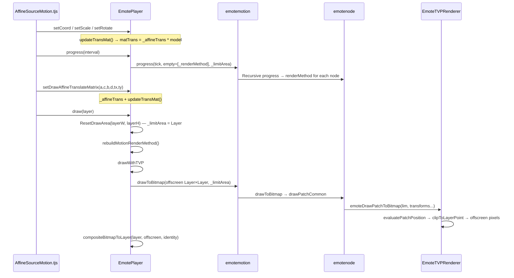

# MotionPlayer Matrix and Coordinate Transformation Pipeline (TVP Implementation)

> **Document Index:** [`README.md`](README.md)  
> Authoritative references: `docs/sdl3/emotefile.cpp` (GPU tessellation), `docs/sdl3/emoteplayerclass.cpp` (Player / FBO)  
> TVP implementation: `emoteplayerclass.cpp`, `EmoteNode.cpp`, `EmoteInternal.cpp`, `EmoteTVPRenderer.cpp`  
> Script entry point: `data/system/AffineSourceMotion.tjs` → `drawAffine`  
> **TVP coordinate system / affine transformation pitfalls:** [`MOTIONPLAYER_TVP_COORDINATES.md`](MOTIONPLAYER_TVP_COORDINATES.md)  
> **Texture positioning in world coordinates (PSB fields + progress implementation):** [`MOTIONPLAYER_TEXTURE_WORLD_COORDS.md`](MOTIONPLAYER_TEXTURE_WORLD_COORDS.md)

**Approach A (2026-06-08):** Align TVP with SDL3 — `_limitArea` = Layer dimensions, tessellation root = `_affineTrans * model`, offscreen = Layer, `compositeBitmapToLayer` uses an identity 1:1 transform. Sections §1–§2 below have been updated accordingly. If the older "PSB two-stage" description in §4 conflicts with these sections, Approach A takes precedence.

This document explains **each coordinate space**, **the responsibilities of each function**, **how matrices are multiplied together**, **the complete call chain**, and how to use the `tri` output from `EmoteDrawDbg sampleIcon` to determine which stage is causing a problem.

---

## 1. Three Coordinate Spaces (Must Be Distinguished First)

| Space | Defined By | Typical Dimensions | Purpose |
|------|------------|--------------------|---------|
| **Emote logical / progress lim** | `emotelimit` propagated through the tree; child blank nodes may be larger than the screen | e.g. 1830×1800, `progressLimMax` | `glm::ortho(lim)` inside `emotenode::progress` writes to `renderMethod.matTrans` |
| **Draw viewport `drawLim`** | `EmotePlayer::_limitArea` = **Layer dimensions** | e.g. 1280×720 | `drawToBitmap`, `clipToLayerPoint` (icon `ortho` uses progress `lim`; see §5.3) |
| **Layer parent affine** | `AffineSourceMotion`'s `calcMatrix` → `setDrawAffineTranslateMatrix` | Pixel-space `tx,ty` + 2×2 matrix | **Multiplied into** the tessellation root as `_affineTrans * model` (SDL3 sign convention) |

```text
Script setCoord/setScale  ──►  model; setDrawAffine ──► _affineTrans
updateTransMat            ──►  renderMethod[0] = _affineTrans * model
emotenode::progress       ──►  renderMethod[1..n-1] (layout + projection*icon)
evaluatePatchPosition     ──►  clip homogeneous coordinates (px,py,pw)
clipToLayerPoint(lim)     ──►  Layer pixels (0..drawLim.w, 0..drawLim.h)
drawToBitmap(offscreen)   ──►  compositeBitmapToLayer(identity) → MainImage
```

**`limMismatch=1` is normal:** A blank subtree during progress can be larger than `drawLim`; SDL3 behaves the same way. The important point is not to eliminate the mismatch, but to ensure that **NDC → viewport conversion** and **tessellation matrix multiplication order** match SDL3.

---

## 2. End-to-End Call Chain (NEKOPARA / Emote Character Sprites)



### 2.1 Script Side (Fixed Order, Affects C++ Design)

`drawAffine` in `data/system/AffineSourceMotion.tjs`:

```javascript
// 1) Emote internal pose (PSB coordinate system)
_player.setCoord(+._imagex, +._imagey);
_player.setRotate(...);
_player.setScale(s);  // s = _emotescale * imagezoom * (100/resolutionx)

// 2) Build the tree (at this point _renderMethod already contains model,
//    but the Layer affine transform has not yet been set)
_player.progress(_interval);  // or progress(0)

// 3) Layer affine (derive the six parameters from Kirikiri Layer's calcMatrix)
var x = mtx.transformAreaX(1, 1);
var y = mtx.transformAreaY(1, 1);
_player.setDrawAffineTranslateMatrix(a, c, b, d, tx, ty);

// 4) Render
_player.draw(target);
```

Therefore, C++ **must call `rebuildMotionRenderMethod()` inside `draw()`, after `setDrawAffine`**, otherwise the nodes' `renderMethod` values will be out of sync with the current frame's Layer affine transform (already implemented).

---

## 3. Core Data Structures

### 3.1 `emotelimit`

```cpp
// emotefile.h (conceptual)
struct emotelimit {
    float originX, originY;
    float width, height;
    float zMax;
};
```

- **progress**: Parent nodes pass `{originX, originY, width, height, zMax}` to their children. A child blank node can be larger.
- **draw**: Offscreen rendering and `clipToLayerPoint` use `_limitArea` (PSB screenSize); `setCoord` requires Layer→draw scaling (see `MOTIONPLAYER_TVP_COORDINATES.md` §7).

### 3.2 `emoteRender` (One Level of the Rendering Stack)

```cpp
// emotefile.h
struct emoteRender {
    int type;           // 0: no rendering
                        // 1: Bézier + matrix
                        // 2: matrix only
                        // 3: layout pass-through / merge
    glm::mat4 matTrans;
    float controlPts[32];
    float opa;
    // originX/Y, width, height — FBO/clipping metadata
};
```

At the end of `progress`, every **icon node** has a `renderMethod` vector:

- `renderMethod[0]`: Root inserted by `EmotePlayer` (`type=3`, `matTrans=model`).
- `renderMethod.back()`: Closest to the leaf, often containing `projection * … * model(icon)`.

### 3.3 Matrices on the `EmotePlayer` Side

| Member | Meaning |
|--------|---------|
| `_renderMethod` | `emoteRender` passed to the tree root; `matTrans = model` |
| `_affineTrans` | Layer affine transform; **used only during compositing** |
| `_limitArea` | Draw viewport (PSB screenSize); `_layerWidth/Height` = Layer dimensions |
| `m_BmpBits` | Offscreen bitmap of size `_width×_height` |

---

## 4. EmotePlayer: Player-Level Functions

### 4.1 `updateTransMat()`

**File:** `emoteplayerclass.cpp`  
**Called by:** `setCoord` / `setScale` / `setRotate` / `ResetDrawArea` (when dimensions change)

```cpp
void EmotePlayer::updateTransMat() {
    _renderMethod.type = 3;
    _renderMethod.opa = 1.0f;
    glm::mat4 model = glm::mat4(1.0f);
    model = glm::translate(model, glm::vec3(currCoordx + currCamX, currCoordy + currCamY, 0));
    model = glm::rotate(model, glm::radians(currAngle), glm::vec3(0.0f, 0.0f, 1.0f));
    model = glm::scale(model, glm::vec3(currZx, currZy, 1.0f));
    _renderMethod.matTrans = model;   // TVP: Layer affine does not enter the stack (see compositeBitmapToLayer)
}
```

**Function:** Combines the script's `setCoord/setScale/setRotate` into the Emote **root matrix** `model`, which becomes `empty[0]` during `progress`.

---

### 4.2 `setDrawAffineTranslateMatrix(a,b,c,d,tx,ty)`

**Function:** Stores the Kirikiri Layer affine transform for a unit square (the six parameters derived from the script's `transformArea(1,1)`). Its matrix semantics match TVP's `t2DAffineMatrix`; see [`MOTIONPLAYER_TVP_COORDINATES.md`](MOTIONPLAYER_TVP_COORDINATES.md) §4.

The script calls `setDrawAffineTranslateMatrix(a, c, b, d, tx, ty)`, so the C++ parameters `(a,b,c,d)` actually correspond to `(m11, m21, m12, m22)`.

```cpp
// TVP pixels: x' = a*x + c*y + tx, y' = b*x + d*y + ty
// (Do not use the OpenGL convention with -b/-c)
_affineTrans = glm::mat4(a, b, 0, 0,
                         c, d, 0, 0,
                         0, 0, 1, 0,
                         tx, ty, 0, 1);
// updateTransMat() only refreshes model;
// it does not write _affineTrans into _renderMethod
```

**TVP vs SDL3 difference:** SDL uses `_affineTrans * model` as the GPU root matrix. TVP must use **only `model`** during offscreen tessellation/orthographic projection, then apply the Layer affine transform to the entire texture during `compositeBitmapToLayer`. Although TVP's backend uses OpenGL, `AffineBlt` exposes a pixel coordinate system with the **origin at the top-left and Y increasing downward** (Y↔NDC conversion happens inside `RenderManager_ogl::OperateTriangles`).

---

### 4.3 `progress(mstime)`

**Function:** Advances the timeline and **builds the tree** (the first time may occur before `setDrawAffine`).

```cpp
std::vector<emoteRender> empty;
empty.push_back(_renderMethod);
_currmotion->progress(tick, empty, _limitArea);
```

- Emote character sprites: `tick=0`, with separate calls to `updateEyeControl` / `updateTimelineControl`.
- MTN: `tick=clockPassed`.

---

### 4.4 `ResetDrawArea(layerW, layerH)`

**Function:** Records the Layer dimensions; `_limitArea` and the offscreen bitmap **retain the PSB `screenSize`** (unlike SDL3; see [`MOTIONPLAYER_TVP_COORDINATES.md`](MOTIONPLAYER_TVP_COORDINATES.md) §7).

```cpp
_layerWidth = layerW; _layerHeight = layerH;
ensureLimitAreaFromFile();  // _limitArea / _width / _height ← screenSize
updateTransMat();
```

---

### 4.5 `rebuildMotionRenderMethod()`

**Function:** Inside `draw()`, after `setDrawAffine`, reruns `emotemotion::progress` using the **latest** `_renderMethod` and `_limitArea`.

```cpp
empty.push_back(_renderMethod);
_currmotion->progress(0 or clockPassed, empty, _limitArea);
```

**Why it is necessary:** Ensures that `model`, after `setCoord` / `setScale`, has been written into each node's `renderMethod`. `setDrawAffine` only affects compositing and does not require rebuilding tessellation, but rebuilding uniformly inside `draw()` is harmless.

---

### 4.6 `draw()` → `drawWithTVP()`

```cpp
void EmotePlayer::draw(...) {
    ResetDrawArea(layerW, layerH);
    rebuildMotionRenderMethod();
    drawWithTVP(layer);
}

void EmotePlayer::drawWithTVP(layer) {
    offscreen->Fill(0);
    _currmotion->drawToBitmap(offscreen, targetClip, _limitArea, nullptr);
    compositeBitmapToLayer(layer, offscreen, _width, _height, _affineTrans);
}
```

---

### 4.7 `compositeBitmapToLayer(..., layerAffine)`

**Function:** Composites the entire offscreen bitmap onto the Layer, using `_affineTrans` to map the offscreen rectangle `(0,0)-(w,h)` into Layer pixel coordinates.

```cpp
// Offscreen triangle → Layer triangle
dstTri[0] = layerAffine * (0, 0)
dstTri[1] = layerAffine * (srcWidth, 0)
dstTri[2] = layerAffine * (0, srcHeight)
mainImage->AffineBlt(dstRect, srcBitmap, srcRect, dstTri, bmCopy, 255, hda=false, ...);
```

This is **not** stretching the entire Layer; it matches the script's "Layer matrix" semantics.

---

## 5. `emotenode::progress` — Tree Construction and `matTrans`

### 5.1 Entry Behavior

```cpp
renderMethod.clear();
renderMethod = renderList;  // Inherit the parent stack (including root model)
```

It then interpolates frame values such as `currCoordx/y`, `currOpa`, and Bézier parameters `currbp`, before constructing `model = T * R * S` (translation → rotation → shear/scale).

### 5.2 `orthoForLim(lim)`

```cpp
glm::mat4 orthoForLim(const emotelimit &l) {
    return glm::ortho(-l.originX, l.width - l.originX,
                      l.height - l.originY, -l.originY, l.zMax, -l.zMax);
}
```

**Important:** A child blank node's `lim` may be larger than `drawLim` (`limMismatch=1`). **For icons, `projection = orthoForLim(current progress lim)`** (same as SDL3), while **`clipToLayerPoint` separately uses `_limitArea` (screenSize)**.

Do not replace `ortho(lim)` with `ortho(drawViewport)`, otherwise the layout stack will become inconsistent with the larger blank coordinate system, and `tri` values may fly far outside the offscreen bitmap (±5000 or more).

### 5.3 Typical Matrix Construction for Drawable Icons (`!isLayout`)

When the parent is a layout (`renderMethod.back().type == 3`):

```cpp
model = translate(-originX-currOx, -originY-currOy) * scale(width, height);
emt.matTrans = projection * emt.matTrans * model;  // projection = orthoForLim(lim)
```

Otherwise:

```cpp
emt.matTrans = projection * model;
```

**Result:** `renderMethod` length = tree depth (`surf=14` in your logs means 14 surface levels).

### 5.4 Passing Values to Child Nodes

```cpp
ch->progress(tick, renderMethod, {originX, originY, width, height, lim.zMax});
```

---

## 6. Rendering Path: From `drawToBitmap` to Pixels

### 6.1 `emotemotion::drawToBitmap`

Traverses icon nodes sorted by Z → `emotenode::drawToBitmap` → `drawPatchCommon(lim, ...)`, where `lim = _limitArea`.

### 6.2 `drawPatchCommon` — Matching SDL3 `glUniform`

In SDL3's `draw()`:

```cpp
for (i = n-1; i >= 0; --i)
    glUniformMatrix4fv(..., "transforms[idxCnt++]", renderMethod[i].matTrans);
```

The TVP equivalent is to **populate in reverse order and evaluate in forward order**:

```cpp
for (int32_t i = 0; i < surfaceCount; ++i) {
    const size_t srcIdx = surfaceCount - 1 - i;
    patchTransforms[i] = renderMethod[srcIdx].matTrans;
    patchControlPoints[i] = (type==1) ? controlPts : default_control_points;
}
emoteDrawPatchToBitmap(target, targetClip, lim,
    surfaceCount, glm::value_ptr(patchTransforms[0]), ...);
```

**Multiplication order (column vectors):**

```text
clipPoint = M[0] * M[1] * ... * M[n-1] * bezierPath(uv)
where M[i] = renderMethod[n-1-i] in the CPU transforms array

Equivalently: renderMethod[n-1] (leaf/icon side) acts on UV first,
and renderMethod[0] (root model) acts last.
```

**Do not** change this to `patchTransforms[i]=renderMethod[i]` in forward order, as that would make the root matrix act on UV first, which is inconsistent with SDL3's `tessEval`.

---

## 7. `evaluatePatchPosition` — CPU Version of `tessEval`

**File:** `EmoteInternal.cpp`  
**Reference:** `main()` in the `tessEvaluationShader` of `docs/sdl3/emotefile.cpp`

### 7.1 Algorithm (For Each Surface Level)

```cpp
// Input: uv ∈ [0,1]²
// (parameter-domain corners; mapping to TVP triangles is described in §9:
//  (1,0)(1,1)(0,0))
for (int i = 0; i < surfaceCount; ++i) {
    if (i > 0) {
        // UV remapping between layers (identical to GLSL)
        px = 1.0f - (oldY / 2.0f + 0.5f);
        py = 0.5f + oldX / 2.0f;
    }
    bezierSurface2D(px, py, controlPoints[i], sx, sy);
    t = glm::mat4(transforms + i*16) * vec4(sx, sy, 0, 1);
    px, py, pz, pw = t;
}
outX = px;
outY = -py;   // Corresponds to gl_Position = lastPt * vec4(1,-1,1,1), flipping Y
outW = pw;
```

**Function:** Transforms parameter-domain coordinates `(u,v)` through 14 layers of Bézier surfaces and matrices, producing **homogeneous clip coordinates** `(outX, outY, outZ, outW)`.

**Limitation (TVP):** SDL uses a 16×16 tessellation grid. When TVP's `kEnableCpuBezierMesh=false` (the default), it uses only **three corners** for a single `AffineBlt` affine approximation. This is **not equivalent** to the full GPU tessellation grid. Large deformations may produce positional differences, but they should not cause the entire geometry to fly far offscreen.

---

## 8. `clipToLayerPoint` — NDC → Offscreen Pixels

**File:** `EmoteTVPRenderer.cpp`

```cpp
void clipToLayerPoint(float px, float py, float pw, const emotelimit &viewportLim, tTVPPointD &out) {
    const float w = (pw != 0.0f) ? pw : 1.0f;
    const double ndcX = px / w;
    const double ndcY = py / w;
    out.x = viewportLim.originX + (ndcX * 0.5 + 0.5) * viewportLim.width;
    out.y = viewportLim.originY + (1.0 - (ndcY * 0.5 + 0.5)) * viewportLim.height;
}
```

**Function:** Equivalent to `glViewport(0,0,lim.width,lim.height)`, followed by conversion to a bitmap coordinate system with its origin at the top-left and Y increasing downward.

**`lim` argument:** Must be **`drawLim` (`_limitArea`)**. Do not apply a second linear scaling of patch coordinates based on `progressLim` (an incorrect approach that has already been reverted).

---

## 9. `affineTargetTriangle` + `AffineBlt`

```cpp
// TVP AffineBlt: p0 = top-left / p1 = top-right / p2 = bottom-left
// (bitmap Y increases downward)
// SDL tessCoord=(v,u): (w,0) maps to patch(0,1),
//                     (0,h) maps to patch(1,0)
evaluatePatchPosition(0,0, ...) → p0;
evaluatePatchPosition(0,1, ...) → p1;
evaluatePatchPosition(1,0, ...) → p2;

// Half-pixel offset (TVP pixel centers)
xOffset = -0.5 - targetClip.left;
yOffset = -0.5 - targetClip.top;

target->AffineBlt(triClip, sourceBitmap, sourceRect, dstTri,
                  bmCopy, opa255, ..., hda=false, ...);
```

| Parameter | Value | Explanation |
|-----------|-------|-------------|
| `hda` | **false** | Matches `Layer::AffineCopy(dfAlpha)`; with `true`, alpha is not written to a transparent destination |
| `triClip` | Triangle bounding box ∩ targetClip | **On macOS, `triClip` must be used as `destrect`**. Using the entire Layer's `targetClip` often produces no output from `OperateTriangles`, with `alphaSamples~=0` |
| `method` | Default blend `bmCopy` | After offscreen `Fill(0)`, `bmAlpha` may still fail to write alpha; matches the CENTER debug path |

---

## 10. SDL3 GPU Path Comparison

| Step | SDL3 | TVP |
|------|------|-----|
| Viewport | `glViewport(0,0,lim.w,lim.h)` | `clipToLayerPoint(drawLim)` |
| Matrix uniforms | `transforms[k]=renderMethod[n-1-k]` | Same order for `patchTransforms` |
| Surface evaluation | `tessEval` 16×16 grid | `evaluatePatchPosition`; defaults to a three-corner affine approximation |
| Y flip | `gl_Position = lastPt * (1,-1,1,1)` | `1 - ndcY` inside `clipToLayerPoint`; **no additional flip during compositing** |
| Layer affine | `_affineTrans * model` in root `renderMethod[0]` | Only in `compositeBitmapToLayer`; `updateTransMat` uses only `model` |
| Output | `glReadPixels` → Layer | Offscreen `m_BmpBits` → `compositeBitmapToLayer` |

---

## 11. How to Read Debug Logs

Example of an incorrect log before the fix (`_affineTrans` incorrectly included in tessellation, `offscreen=800×1080`):

```text
tri=(-9311.7,8318.4)(-9212.9,8305.2)(-9312.1,8200.1) inOffscreen=0 alphaSamples~=0
```

Expected output after the fix (`tri` inside the screenSize offscreen bitmap):

```text
drawLim=800x1080
tri falls within [0,800)×[0,1080)
inOffscreen=1  alphaSamples~ > 0
```

| Field | Meaning |
|-------|---------|
| `surf` | `renderMethod.size()`; the entire stack participates in `evaluatePatchPosition` (normal; may be >1) |
| `tri` | Sample icon coordinates in **offscreen pixels**; should align with `drawLim` (screenSize), **not** Layer dimensions |
| `inOffscreen=0` | Triangle is outside the offscreen bitmap → tessellation/orthographic projection problem, or `_affineTrans` was incorrectly included in tessellation |
| `progressLimMax` / `limMismatch=1` | Blank subtree larger than screenSize; **can be ignored** if `tri` is already inside `drawLim` |
| `alphaSamples~` | Number of nontransparent offscreen pixels; should be >0 before compositing |

**Recommended debugging order:**

1. `EMOTE_DRAW_DEBUG_CENTER=1`: If the center grid is visible, texture loading and compositing work; the problem is in the matrix chain.
2. Check whether `tri` changes reasonably with `setCoord` / `setScale`.
3. Compare against SDL3's GPU output for the same PSB and frame (if an SDL3 build is available).

---

## 12. Related File Index

| File | Responsibility |
|------|----------------|
| `data/system/AffineSourceMotion.tjs` | `drawAffine` script call order |
| `emoteplayerclass.cpp` | Player, offscreen rendering, compositing, `rebuildMotionRenderMethod` |
| `EmoteNode.cpp` | `progress` tree construction, `drawPatchCommon` |
| `EmoteInternal.cpp` | `evaluatePatchPosition` |
| `EmoteTVPRenderer.cpp` | `clipToLayerPoint`, `affineTargetTriangle`, `AffineBlt` |
| `EmoteDrawDebug.cpp` | `sampleIcon` / `tri` / `inOffscreen` statistics |
| `docs/sdl3/emotefile.cpp` | `tessEval` + draw uniforms |
| [`MOTIONPLAYER_DRAW_VISIBILITY.md`](MOTIONPLAYER_DRAW_VISIBILITY.md) | Visibility, `hda`, and offscreen rendering problems |
| [`MOTIONPLAYER_TVP_COORDINATES.md`](MOTIONPLAYER_TVP_COORDINATES.md) | TVP vs OpenGL coordinates, `t2DAffineMatrix`, common matrix errors |
| [`README.md`](README.md) | Document index |

---

## 13. Known Limitations and Open Issues

1. **CPU three-corner affine vs GPU full tessellation:** Heavily deformed areas (such as hair with `isNeedBp`) will differ in shape from SDL. This should not cause the entire `tri` geometry to move far outside the screen.
2. **Large `surf` values:** `evaluatePatchPosition` must process each level individually. The stack cannot be collapsed into a single matrix because the inter-layer UV remapping is nonlinear.
3. **Layer affine (TVP):** Do not incorporate `_affineTrans` into `renderMethod`; apply it only in `compositeBitmapToLayer`. The SDL GPU path can combine these transforms.
4. **If `inOffscreen=0` still occurs:** First inspect the numeric values of the `renderMethod` stack (progress), `drawLim`, and the corner outputs from `evaluate`. Do not scale patch coordinates using `progressLim`.

---

*Document version: 2026-06-08. TVP two-stage pipeline: tessellation uses PSB screenSize + `model`; compositing uses `_affineTrans` (t2DAffine).*
