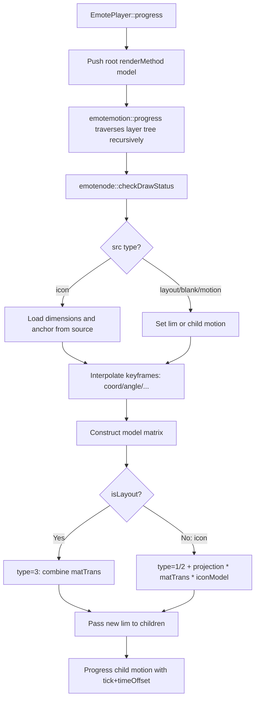

# E-mote Texture World Coordinates: Data Structures and Implementation

> **Document index:** [`README.md`](README.md)  
> **Sample asset:** [`tests/test_files/emote/e-mote3.0バニラパジャマa.json`](../../../../tests/test_files/emote/e-mote3.0バニラパジャマa.json)  
> **Related documents:**  
> - [`MOTIONPLAYER_PSB_STRUCT.md`](MOTIONPLAYER_PSB_STRUCT.md) — PSB/JSON field reference  
> - [`MOTIONPLAYER_MATRIX_PIPELINE.md`](MOTIONPLAYER_MATRIX_PIPELINE.md) — Matrix multiplication and the `draw` call chain  
> - [`MOTIONPLAYER_TVP_COORDINATES.md`](MOTIONPLAYER_TVP_COORDINATES.md) — TVP pixel coordinates and affine-transform pitfalls  
> **Core code:** `EmoteNode.cpp`, `EmoteFrame.cpp`, `EmoteFileCore.cpp`, `emoteplayerclass.cpp`, `EmoteTVPRenderer.cpp`

This document explains **where each texture ultimately appears in Emote's logical world coordinate system**, which PSB fields determine that position, and how KrKr2's `motionplayer` converts those fields into transformation matrices during `progress` and `draw`.

---

## 1. Key Conclusions

A texture's **world coordinates are not stored in any single field** under `source`. Instead, they result from the following factors being **multiplied together level by level along the `layer` tree**:

| Level | Data source | Purpose |
|-------|-------------|---------|
| World coordinate system definition | `screenSize` | Logical canvas bounds and origin |
| Node-local transform | `coord/angle/sx/sy/zx/zy/ox/oy/mesh` in `frameList[].content` | Translation, rotation, scaling, shearing, and mesh deformation in the parent's coordinate system |
| Coordinate region | `src: "layout"` / `src: "blank/w:h:ox:oy"` | Defines the `emotelimit` available to the subtree (width, height, origin) |
| Texture anchor | `source.<group>.icon.<name>.originX/Y` | Texture-local pivot, determining which point on the image `coord` attaches to |
| Child motion reference | `src: "motion/..."` | Nests another motion tree with a `timeOffset` |
| Discrete parameters | `parameterize` + `motion.parameter` + `metadata.variableList` | Maps variable values to different `tick` values, switching keyframes |
| Physics/controls | `bustControl`, `hairControl`, etc. | Indirectly modifies subtree poses through variables |
| Player root transform | `EmotePlayer.setCoord/setScale/setRotate` | Global translation, rotation, and scaling of the entire Emote tree |
| Screen compositing | `setDrawAffineTranslateMatrix` + `compositeBitmapToLayer` | Composites the offscreen result into Kirikiri Layer pixel space |

**Leaf icon nodes** (such as `src: "src/body_parts/下半身00"`) often **have no `coord` field**. Their world position is determined entirely by ancestor layout/blank/deformation nodes. `source.originX/Y` defines only a **local anchor**, not world coordinates.

---

## 2. Coordinate Spaces (Relationship to the Matrix Pipeline Document)

The implementation distinguishes at least three spaces (see [`MOTIONPLAYER_MATRIX_PIPELINE.md`](MOTIONPLAYER_MATRIX_PIPELINE.md) §1):

```text
┌─────────────────────────────────────────────────────────────┐
│  Emote logical world (screenSize + layer-tree progress)      │
│  Example: 800×1080; a blank subtree can extend to 1830×1800 │
└──────────────────────────┬──────────────────────────────────┘
                           │ glm::ortho(lim) + renderMethod stack
                           ▼
┌─────────────────────────────────────────────────────────────┐
│  Offscreen bitmap / drawLim                                  │
│  (EmotePlayer::_limitArea, often equal to Layer dimensions)   │
└──────────────────────────┬──────────────────────────────────┘
                           │ compositeBitmapToLayer(_affineTrans)
                           ▼
┌─────────────────────────────────────────────────────────────┐
│  Kirikiri Layer pixels (top-left origin, Y increases down)   │
└─────────────────────────────────────────────────────────────┘
```

“World coordinates” in this document primarily refers to **the first space: Emote's logical world**, based on `screenSize` and propagated along the tree in `emotenode::progress`.

---

## 3. PSB/JSON Data Model

### 3.1 `screenSize` — World Coordinate System Bounds

```json
"screenSize": {
  "width": 800,
  "height": 1080,
  "originX": 0,
  "originY": 0
}
```

- **Parsing:** `EmoteFileCore.cpp` → `emotefile::_screenSize`
- **Runtime:** Passed as the initial `emotelimit` into the root `emotemotion::progress`; `orthoForLim` uses `{originX, originY, width, height, zMax}` to construct an orthographic projection.
- **Note:** On the TVP path, `_limitArea` / the offscreen area = **the PSB's `screenSize`**; Layer dimensions are used only for compositing. A blank subtree during `progress` can be larger than `screenSize` (`limMismatch` is normal).

### 3.2 `object` → `motion` → `layer[]` — Scene Graph

Character parts are organized into a **directed tree**:

```text
object.all_parts.motion.全体構造
  └── layer[] (root list, drawn in priority order)
        └── children[] (recursive child nodes)
              └── frameList[] (the node's timeline keyframes)
```

Among each `layer` node's fields (full table in [`MOTIONPLAYER_PSB_STRUCT.md`](MOTIONPLAYER_PSB_STRUCT.md) §8), those directly related to pose are:

| Field | Description |
|-------|-------------|
| `label` | Node name, used for debugging and lookup via `getNodeByName` |
| `type` | Node type (0 = ordinary, 12 = template composition, etc.) |
| `frameList` | Keyframe sequence |
| `children` | Child nodes; their `lim` is determined by this node's `originX/Y/width/height` |
| `parameterize` | If non-null, this node (and all child nodes within the motion) uses a variable-driven `tick` |
| `inheritMask` | Transform inheritance mask (some branches are not fully implemented) |
| `meshDivision` / `meshCombine` / `meshTransform` | Mesh subdivision and combination strategies |

### 3.3 `frameList[].content` — Per-Frame Transforms and Resource References

`EmoteFrame.cpp` parses numeric fields from `content`; `EmoteNode::checkDrawStatus` determines the node type from `src`.

**Transform fields (sources for interpolation):**

| Field | Member variable | Default | Meaning |
|-------|-----------------|---------|---------|
| `coord` [x,y,z] | `coordX/Y/Z` | 0 | Translation in the parent coordinate system; `z` affects depth penetration |
| `angle` | `angle` | 0 | Rotation around Z (degrees), with special interpolation across 0°/360° |
| `sx`, `sy` | `sx`, `sy` | 0 | Shear (skew) |
| `zx`, `zy` | `zx`, `zy` | 1 | Scale |
| `ox`, `oy` | `ox`, `oy` | 0 | Additional drawing offsets (added to the icon anchor) |
| `opa` | `opa` | 1 | Opacity |
| `mesh.bp` | `bp[32]` | Identity mesh | Bézier surface control-point offsets |
| `timeOffset` | `timeOffset` | 0 | Time offset when referencing a child motion |

**Special `coord` values (adjusted dynamically in `progress`):**

- `NaN` → replaced with `-lim.originX` or `-lim.originY`
- `Inf` → replaced with `lim.width - originX` or `lim.height - originY`  
  Used for edge-aligned keyframes; the actual pixel value is determined by the parent `lim`.

**Four `src` parsing paths (`checkDrawStatus`):**

| `src` form | Node type | Behavior |
|------------|-----------|----------|
| `src/<group>/<icon name>` | `isIcon = true` | Looks up `source.<group>.icon.<name>`, sets `width/height/originX/originY`, and decodes pixels |
| `layout` / `clip` | `isLayout = true` | Inherits the parent `lim` dimensions and origin; does not draw, only propagates/combines matrices |
| `motion/<path>` | Reference to `emotemotion` | Child-tree timeline; `progress(tick + timeOffset, ...)` |
| `blank/w:h:ox:oy` | Layout-like | Custom child coordinate region: `width×height`, origin `(ox,oy)` |

**Example texture reference path:**

```json
"src": "src/body_parts/下半身00"
```

Parsing: `findsourceByName` splits the path at `/` → `source["body_parts"].icon["下半身00"]` (`EmoteFileCore.cpp`).

### 3.4 `source` — Texture Resources and Local Anchors

```json
"source": {
  "body_parts": {
    "icon": {
      "下半身00": {
        "width": 438,
        "height": 853,
        "originX": 219,
        "originY": 426.5,
        "clip": { "left": 0.044, "top": 0.045, "right": 0.956, "bottom": 0.955 },
        "pixel": { "__psb": "resource", "index": 69, ... }
      }
    }
  }
}
```

| Field | Role in world coordinates |
|-------|---------------------------|
| `width`, `height` | Texture quad dimensions; used in `scale(width, height)` |
| `originX`, `originY` | **Local pivot:** `translate(-originX - ox, -originY - oy)` before drawing |
| `clip` | UV cropping (subrectangle within a texture atlas) |
| `pixel` | PSB chunk index, decoded using RL or other compression |

**Distinguish the two kinds of “origin”:**

- `source.originX/Y`: The **texture's own** attachment point (relative to the texture's top-left corner)
- `blank/...:ox:oy` or the parent `lim.originX/Y`: The **node coordinate system's** origin (relative to the parent world)

### 3.5 Metadata: Parameters, Physics, and PSD Import

| Data | Does it directly position textures at runtime? |
|------|------------------------------------------------|
| `metadata.variableList` + `motion.parameter` + `parameterize` | ✅ Indirectly: changes which `tick` a node uses |
| `metadata.timelineControl` | ✅ Timeline variable curves |
| `bustControl` / `hairControl` / `partsControl` | ✅ Physics simulation writes values back to variables |
| `metadata.psdScrapbookImportInfoMap`, etc. | ❌ Editor PSD import information, not read by the current C++ renderer |

---

## 4. Implementation: How `progress` Computes World Matrices

### 4.1 Overall Flow



Entry point (`emoteplayerclass.cpp`):

```cpp
std::vector<emoteRender> empty;
empty.push_back(_renderMethod);  // Root model written by updateTransMat()
_currmotion->progress(tick, empty, _limitArea);
```

### 4.2 Keyframe Selection and Interpolation

`checkDrawStatus(tick)`:

1. Finds the last frame in `frameList` satisfying `frame.time <= tick`.
2. If the next frame also has `content`, linearly interpolates `coord/angle/sx/sy/zx/zy/ox/oy/opa/bp`.
3. Parameterized nodes (`isParameterize`) first replace `tick` with `getTickByIdx(parameterIdx)`:

```cpp
// EmoteMotion.cpp
float emotemotion::getTickByIdx(int32_t parameterIdx) {
    // Read current variable value from variableList → transToTick()
    // tick = division * ((currVal - rangeBegin) / (rangeEnd - rangeBegin))
}
```

Thus, `head_LR = 15` causes a node with `parameterize: 6` to select keyframes at the corresponding time, changing `coord` and other values.

### 4.3 Constructing a Single Node's `model` Matrix

Composition order in `EmoteNode.cpp` (the comments note that this is the reverse of the GLM call order, i.e., right-multiplication semantics):

```text
model = T(coordX, coordY, 0)
      × R(angle)
      × Shear(sx, sy)
      × S(zx, zy, 1)
```

### 4.4 The `renderMethod` Stack and Its Three Types

`emoteRender` (`emotefile.h`):

| type | Meaning |
|------|---------|
| 0 | Do not draw; cut off the subtree |
| 1 | Matrix + Bézier mesh (`controlPts`) |
| 2 | Matrix only |
| 3 | Layout/motion: pass and combine matrices into the next level, without independent opacity/mesh |

**Layout nodes (`isLayout`):** Multiply `model` into the `matTrans` of the topmost stack entry if `type==3`, or create a new `type=3` entry. **Nothing is drawn.**

**Icon nodes (`isIcon`):** On top of the parent layout matrix:

```cpp
model = translate(model, vec3(-originX - currOx, -originY - currOy, 0));
model = scale(model, vec3(width, height, 1));
emt.matTrans = projection * parentLayout.matTrans * model;
```

Here `originX/Y` comes from `source` (copied into the node when the icon is loaded), and `projection = orthoForLim(drawViewport)`.

### 4.5 Passing `lim` to Child Nodes

At the end of each node's `progress`:

```cpp
for (auto ch : children)
    ch->progress(tick, renderMethod,
                 { originX, originY, width, height, lim.zMax },
                 drawViewport);
```

A child node's `coord` is a translation **relative to that `lim` coordinate system**. Its world pose is the product of all ancestor `model` and combined layout matrices.

### 4.6 Drawing Stage

`drawToBitmap` / `drawPatchCommon`:

1. Retrieves the `renderMethod` stack (passed to tessellation in reverse order, consistent with SDL3).
2. `emoteDrawPatchToBitmap` → `evaluatePatchPosition` transforms unit-patch vertices into clip space.
3. `clipToLayerPoint(drawLim)` maps them to offscreen pixels.
4. `EmotePlayer::compositeBitmapToLayer` composites the result onto the Layer using `_affineTrans`.

Final on-screen texture position = **world matrix stack** × **Player root model** × **Layer affine transform**.

---

## 5. Example: Tracing the World Coordinates of the “Lower Body” Texture

### 5.1 Leaf Node (`src` Only, No `coord`)

```json
{
  "label": "■下半身",
  "frameList": [{
    "time": 0,
    "type": 2,
    "content": {
      "src": "src/body_parts/下半身00",
      "ox": 0, "oy": 0,
      "mask": 131073,
      "bm": 0
    }
  }]
}
```

This node defaults to `coord = 0`; its world position = parent-chain transforms × anchor correction.

### 5.2 Texture Anchor

```json
"下半身00": {
  "width": 438,
  "height": 853,
  "originX": 219,
  "originY": 426.5
}
```

Drawing is equivalent to first aligning the image's bottom-left corner with the parent's `coord`, then offsetting it toward the upper-left by `(219+ox, 426.5+oy)`, and finally filling a `438×853` quad.

### 5.3 Typical Parent Chain

In `motion.body_parts.下半身変形基礎`, common ancestor-node combinations include:

1. **`blank/480:937:240:468`** — Lower-body deformation region (width 480, height 937, origin 240,468).
2. **`mesh.bp` keyframes** — Bézier deformation (such as leaning the body left or right).
3. **`parameterize: 6`** — Binds variables such as `body_LR` to drive `coord`/`angle` at different `tick` values.
4. Higher-level **`layout` + `coord`** — For example, overall translation by the full-body `move_UD`/`move_LR`.

To inspect this, search **upward** from `■下半身` in the JSON through the parent `frameList` entries, accumulating each level's `coord` and `mesh` effects. For exact values, run `progress` or use `EmoteDrawDbg sampleIcon`.

---

## 6. Additional Script-Level Transforms

The `drawAffine` sequence in `data/system/AffineSourceMotion.tjs` (order must be preserved):

```javascript
// 1) Emote root pose (move/scale/rotate the entire logical world)
_player.setCoord(+._imagex, +._imagey);
_player.setRotate(...);
_player.setScale(s);

// 2) Build the tree
_player.progress(_interval);

// 3) Kirikiri Layer affine transform (screen pixels)
_player.setDrawAffineTranslateMatrix(a, c, b, d, tx, ty);

// 4) Draw
_player.draw(target);
```

- `setCoord`, etc. → `updateTransMat()` → `_renderMethod.matTrans` becomes the base of the `progress` stack.
- `setDrawAffineTranslateMatrix` → changes only `_affineTrans`, used in `compositeBitmapToLayer` (on the TVP path it does not enter the tessellation stack; see [`MOTIONPLAYER_TVP_COORDINATES.md`](MOTIONPLAYER_TVP_COORDINATES.md)).

---

## 7. Debugging and Validation

| Method | Purpose |
|--------|---------|
| [`e-mote3.0バニラパジャマa.json`](../../../../tests/test_files/emote/e-mote3.0バニラパジャマa.json) | Compare PSB fields with the tree structure |
| `EmoteDrawDbg sampleIcon <label>` | Inspect tessellated triangle vertices for a node with the given `label` (to identify matrix-stage errors) |
| `motionplayer-dll` unit tests | PSB loading regression tests |
| `tests/test_files/render/motionplayer_render.tjs` | End-to-end rendering |

To identify which stage contains a pose bug (adapted from the matrix pipeline document):

1. `tri` is already wrong in Emote world space → inspect `coord` / `blank` / `parameterize` in the `layer` tree.
2. World space is correct but the offscreen result is wrong → inspect `ortho` / `drawViewport` / `clipToLayerPoint`.
3. Offscreen result is correct but the Layer is wrong → inspect the argument order of `setDrawAffineTranslateMatrix`.

---

## 8. Relationship to Editor/Import Data

`metadata.psdScrapbookImportInfoMap`, `psdLayoutImportInfoMap`, and similar fields retain **import-time** reference information, such as PSD layer names, `clipRect`, and `z` order. The current KrKr2 runtime code **does not read** those fields to position textures. Actual poses are determined by the baked `frameList` entries in the `motion.layer` tree.

If a layer is moved in the editor and the PSB is exported again, the `coord` and `blank` values in `frameList` will be updated, while `source.originX/Y` generally describes the texture's own pivot and may not change when the entire layer is translated.

---

## 9. Summary of Design Considerations

1. **Scene graph + timeline:** Poses are a tree-structure problem, not a flat table of texture coordinates.
2. **Separation of layout and icon:** Intermediate nodes modify matrices without drawing, reducing the number of FBO layers. Only leaf icon nodes decode pixels.
3. **Dual-origin model:** `lim.origin` defines a child coordinate system, whereas `source.origin` defines the texture attachment point. During drawing, ancestor matrices are combined before subtracting the texture anchor.
4. **Parameterization = changing `tick`:** Expressions and body angles are not stored directly in icon nodes; `parameterize` selects keyframe times instead.
5. **Large blank coordinate systems:** Deformation subtrees commonly use blank regions much larger than `screenSize` (such as `1830×1800`). The `progress` limit and drawing limit can differ; projection must use `drawViewport` to prevent coordinate overflow.

---

## 10. File Index

| File | Responsibility |
|------|----------------|
| `EmoteFileCore.cpp` | Loads `screenSize`, `source`, and `object` |
| `EmoteMotion.cpp` | Builds the `layer` tree, `parameter`, and `getTickByIdx` |
| `EmoteNode.cpp` | `checkDrawStatus`, the `progress` matrix stack, and `drawPatchCommon` |
| `EmoteFrame.cpp` | Parses numeric fields in `frameList.content` |
| `EmoteTimeline.cpp` / `EmotePhysics.cpp` | Timeline and physics write-back to variables |
| `emoteplayerclass.cpp` | Root `model`, `_limitArea`, and `draw` orchestration |
| `EmoteTVPRenderer.cpp` | Tessellation, `evaluatePatchPosition`, and `clipToLayerPoint` |
